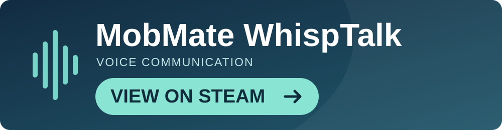

# MobMate WhispTalk — Source Code

[English](README.md) | [日本語](README.ja.md) | [简体中文](README.zh-CN.md)

MobMate WhispTalk is a voice communication app for speaking and following conversations.
It can recognize microphone speech and synthesize speech from recognized or typed text.
The source also includes translation, incoming-audio hearing, and subtitle features.
Availability depends on compatible models, runtimes, devices, and settings; this source candidate has not been run or device-tested.

**Official MobMate binaries are distributed only on [Steam](https://store.steampowered.com/app/4261090/).**
Third-party builds made from this source are not official releases. Forks for improvements and experiments are welcome.
For unofficial distributions, please use a name and presentation that users can distinguish from the official release, and provide your own contact information.
This does not add conditions to the code license or restrict use, modification, or redistribution in accordance with the applicable licenses.

## Where to start

- Start with [.NET Core](src/MobMate.Core/), the [Windows host](src/MobMate.App.WebHost/Program.cs), the [Linux host](src/MobMate.App.Linux/Program.cs), the [C++ bridge](native/mobmate_native_core/), or the [Web UI](web/index.html).
- The source, UI, presets, and tests can be read and edited here. Building needs external dependencies; voice checks and some tests also need models, devices, fixtures, or original records. See [BUILDING.md](BUILDING.md).
- Documentation and localization, UI accessibility, and reproducible tests are examples of welcome improvements; see [CONTRIBUTING.md](CONTRIBUTING.md).

## Current status

This repository contains source code. It does not contain the source snapshot's Git history, private distribution workflows,
Steamworks SDK/runtime, models, the original distribution's icons and images, audio, or distribution binaries.
This source configuration has only been checked statically; no actual build, application launch, CI, or device testing has been performed.
[BUILDING.md](BUILDING.md) describes the Windows/Linux procedures, external dependencies, and missing components.

Catalogs such as the model list are configuration data, not the models themselves. In particular,
the “bundled” label and notice for `tsukuyomi-rvc` in `libs/preset/voiceconv_catalog.json` describe the original distribution;
**the model is not included in this repository**. Do not redistribute external materials without authorization when their conditions have not been checked.

## Licensing policy

For the main application, the policy is **GPL-3.0-only** to the extent that the rights are held and can be licensed.
The license text is in [LICENSE](LICENSE). Where terms different from the GPL are needed, separate licensing may be considered only within the scope of rights held.
This does not imply that a separate license covers third-party materials or unconfirmed rights, establish the licensing entity, or form an agreement.

The formerly published V1 was a Java fork of misterWhisper; V2 is a new development.
The original MIT license for V1 at [`e112427f88d2952fee9aef9f0fefc5b3cb6fb328`](https://github.com/zufall-upon/MobMate/tree/e112427f88d2952fee9aef9f0fefc5b3cb6fb328)
is preserved in [licenses/MobMate-v1-e112427-MIT.txt](licenses/MobMate-v1-e112427-MIT.txt).
The V1 MIT license is not revoked or replaced by the V2 GPL policy.
Similar functionality alone does not mean that V2 was ported or copied from V1.
The terms of third-party materials in V2 and the scope of rights that can be separately licensed must be checked separately.

For third-party notices and individual terms, see [THIRD_PARTY_LICENSES.txt](THIRD_PARTY_LICENSES.txt) and
[licenses/README.md](licenses/README.md). The notices also describe materials in the original distribution that are
not included in this repository. External models and dependencies are subject to their own terms.
[Valve's guidance](https://partner.steamgames.com/doc/sdk/uploading/distributing_opensource) calls attention to combining
the Steamworks SDK with the GPL and similar licenses. Specific rights and distribution methods require separate confirmation.
The draft consent for external PRs to be merged into the main application is in [CONTRIBUTING.md](CONTRIBUTING.md).
